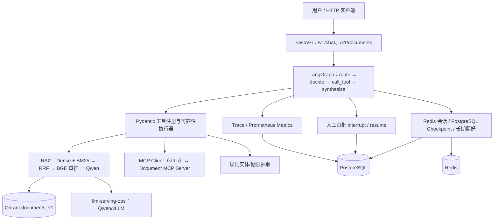

# DocMind-Agent｜复杂文档知识 Agent（中文说明）

[原版 README](README.md) · **[完整中文学习手册](docs/LEARNING_GUIDE_CN.md)** · [API 说明](docs/API.md) · [M9 验收记录](docs/M9_ACCEPTANCE.md) · [简历项目材料](docs/RESUME_PROJECT.md)

> 一个面向合同、法律及政务类**文本**文档的本地 RAG + LangGraph Agent 工程项目。目标是展示可追溯的文档问答、可控工具调用、状态记忆、MCP、人工审批、评测与可观测性，而非生产级法律意见服务。

## 1. 目前完成了什么？

**截至 2026-10-15，M0–M9 核心功能均已通过本地验收。** M9 BASE 使用真实 Docker 组件完成 7 个合成业务阶段；M9 LIVE 经修复 CPU 重排超时后，成功通过一次真实 Qwen 问答、付款期限检查、来源引用校验和 LLM Trace 校验。

**仍未完成的发布检查**：可选 Grafana 看板尚未成功拉取镜像并独立验收；由于 Docker 镜像源/代理问题，包含最新修复的全新不可变 API 镜像尚未完整重建。M9 LIVE 是在原有 API 容器中更新源码后通过的。详见 [发布检查表](docs/RELEASE_CHECKLIST.md)。项目不是已上线产品，也未进行可靠的真实法律数据泛化测试。

| 里程碑 | 当前能力 | 本地验收 |
|---|---|---|
| M0–M1 | FastAPI、PostgreSQL/Redis/Qdrant、TXT/PDF/DOCX 解析、分块与索引 | 通过 |
| M2 | BGE Dense + 中文 BM25 + RRF + BGE Reranker + 来源引用 + Qwen | 通过 |
| M3 | LangGraph 状态图、有限步工具调度、规则路由与受约束模型排序 | 通过 |
| M4 | Redis 多轮会话、显式长期偏好、PostgreSQL Checkpoint | 通过 |
| M5 | 独立 stdio MCP Document Server、真实 Client 调用 | 通过 |
| M6 | 工具超时/重试/Fallback、LangGraph HITL 审批恢复 | 通过 |
| M7 | RAG/Agent/系统性能合成评测 | 通过 |
| M8 | PostgreSQL Trace、Prometheus 指标 | 核心通过，Grafana 待验 |
| M9 | 跨模块业务 Demo（BASE + 真实 Qwen LIVE） | 通过 |

## 2. 整体架构



**一条最典型的问答链路**：先上传合同并索引 → 调用 `POST /v1/chat` → LangGraph 根据问题决定调用 `search_documents` → 混合检索找到有来源的 Chunk → BGE Cross-Encoder 重排 → 将少量证据与问题交给 Qwen → Python 校验 `[S1]` 等引用编号 → API 返回答案、文件/页码/Chunk 来源及 Trace。

**注意三个容易误解的地方：**

1. 不是所有 Agent 请求都调用模型做规划；简单请求由**确定性规则**决定工具。只有满足条件的复杂抽取/摘要任务才可能调用 Qwen 调整允许工具的顺序。
2. 这里的中文 BM25 在限定范围内扫描已索引的 Qdrant Chunk 文本计算词法相关性，**不是独立的大规模倒排索引服务**。
3. 引用校验能检查来源编号、文档/片段对应关系，**不能证明回答中的每一个事实都被证据语义蕴含**。

## 3. 技术栈与职责

| 技术 | 在本项目里承担的工作 |
|---|---|
| Python 3.12 / FastAPI / Pydantic | HTTP API、请求校验、依赖生命周期 |
| LangGraph | 有向状态图、节点路由、Checkpoint、Human-in-the-Loop |
| PostgreSQL / asyncpg / Psycopg | 文档元数据、长期偏好、审批、Trace 和 LangGraph Checkpoint |
| Redis | 最多 6 轮近期会话、1 小时空闲 TTL、同会话互斥 |
| Qdrant | `documents_v1` 的 512 维向量及来源 Payload；`memories_v1` 的偏好向量 |
| FastEmbed + ModelScope BGE | 本地 CPU ONNX Embedding（`bge-small-zh-v1.5`） |
| BM25 + RRF + BGE Reranker | 中文双字词法匹配、排名融合和 Cross-Encoder 重排 |
| Qwen3-0.6B / vLLM | 经 OpenAI 兼容 HTTP API 完成有证据问答和有限工具排序 |
| MCP Python SDK | 标准 stdio 协议的文档工具发现和调用 |
| Prometheus / Grafana（可选） | 请求、工具、LLM 及阶段延迟指标（Grafana 本机尚未验收） |
| Docker Compose / GitHub Actions | 本地多容器部署与 CI 单元测试 |

## 4. 阅读源码从哪里开始？

```text
app/main.py                   应用启动与服务依赖
app/api/documents.py          上传与索引 API
app/rag/parser.py             PDF/DOCX/TXT 文本解析
app/rag/chunker.py            带页码、偏移量的确定性分块
app/rag/retriever.py          Dense + BM25 + RRF
app/rag/pipeline.py           重排、证据构造、Qwen、引用校验
app/api/chat.py               会话/偏好/审批入口和 Agent 调用
app/agent/graph.py            LangGraph 节点与条件边
app/agent/router.py           规则路由与模型规划约束
app/agent/nodes.py            节点执行、工具调用及全局引用合并
app/tools/registry.py         工具参数类型与白名单
app/mcp_client/adapter.py     官方 MCP ClientSession + stdio
mcp_server/server.py          官方 FastMCP Server
app/memory/                   Redis、长期偏好、Checkpoint
app/approvals/                人工审批状态机与幂等写入
app/observability/            Trace、Prometheus、持久化
eval/                         检索、Agent、系统评测
scripts/                      Windows 一键验收脚本
```

**最推荐的第一次学习顺序：** `app/api/chat.py` → `app/agent/graph.py` → `app/agent/nodes.py` → `app/tools/registry.py` → `app/rag/pipeline.py`。先理解“一次请求经历什么”，再分别钻研 RAG、记忆、MCP 和 HITL。

→ **[从零理解本项目：完整中文学习手册（含逐步源码追踪、动手练习、Agent 面试高频题和故障排查）](docs/LEARNING_GUIDE_CN.md)**

## 5. 运行方式（Windows CMD）

### 环境

Windows + Docker Desktop（WSL2）、Git，以及已配置的 Docker Compose。**如果本地已有 .env，不要用示例配置覆盖它；只有首次安装且不存在 .env 时才执行下面的 copy 命令。**项目 API 主机端口为 **8090**，API 容器内监听 **8000**；独立的 `llm-serving-ops` 在 Windows 主机 **8000** 端口提供 Qwen/vLLM。

```cmd
cd /d E:\project\DocMind-Agent
copy .env.example .env
docker compose up -d
docker compose ps
curl --noproxy "*" http://127.0.0.1:8090/health
```

如果尚无 API 镜像，理论上可以用 `docker compose up -d --build api` 构建；**但近期 Docker Hub 镜像代理/DNS 出现超时与 EOF，不能把“构建失败”误诊为 Python 业务错误**。已经验收的现有容器无需反复重建，模型缓存也不应删除。切勿随意执行 `docker compose down -v`。

### 文件上传（真实文件）和索引

```cmd
curl --noproxy "*" -X POST -F "file=@data/samples/sample_contract.txt" http://127.0.0.1:8090/v1/documents
```

返回 `document_id` 后：

```cmd
set DOC_ID=这里替换为文档UUID
curl --noproxy "*" --max-time 600 -X POST http://127.0.0.1:8090/v1/documents/%DOC_ID%/index
```

上传与索引是**两个独立请求**：上传只保存原件和 PostgreSQL 元数据，索引才执行分块、Embedding 和 Qdrant 存储。

### 现有 Demo 脚本

```cmd
scripts\check_m9.bat
scripts\check_m9_live.bat
```

二者均已在本机通过验收；LIVE 需要 Qwen/vLLM，且 CPU BGE 重排可能比较慢。只是阅读和学习时**无需重新跑昂贵的 LIVE 测试**。具体命令和风险见 [M9 Demo 指南](docs/M9_DEMO.md)。

## 6. 实际参数与功能边界

- 文档格式：文本型 PDF、DOCX、TXT；上传大小最大 **10 MiB**；**不支持 OCR 扫描件**。
- 默认分块：`chunk_size=400` 字符、`overlap=60` 字符；PDF 不跨页合并。
- Embedding：BGE Small 中文模型，**512 维**；混合检索默认候选 `8` 个，最终证据 `2` 个，每条证据截取最多 `160` 字符给模型。
- 工具执行：LangGraph 最多 **8** 个工具步骤；普通只读工具临时故障最多重试 **2** 次。CPU RAG/摘要预算默认 **420 秒且不重试**，避免重复运行未取消的 ONNX 线程。
- 长期记忆：只支持**显式指令**保存白名单中的合同分析输出格式，不是任意事实的自动记忆。
- 写入操作：仅 `save_review_note` 属于审批保护范围；未批准不会写入。
- 用户 `user_id` / `session_id` 是本地 Demo 身份字段，**不是安全认证**。

## 7. 测试证据怎么正确理解？

- **M7a**：3 个合成查询的文档级 Recall@3、MRR@3 均为 **1.0**。
- **M7b**：7 个合成 Agent 任务，Task Success Rate 与 Tool Selection Accuracy 均为 **1.0**，共 8 次成功工具调用。
- **M7c**：仅少量串行样本；独立 CPU BGE 重排分别耗时约 **172 秒**和 **259 秒**，不是生产环境吞吐基准。
- **M9**：BASE 的 7 项合成流程检查及 LIVE 的真实 Qwen 问答/引用检查通过。

这些数字反映**合成测试链路的正确性**，不应宣传成真实法律文本的泛化准确率。

## 8. 学习与面试资料

- **[详细项目学习手册（中文）](docs/LEARNING_GUIDE_CN.md)**：从 HTTP/Python/状态机/RAG 基础讲起，逐步分析真实源码、工具生命周期、记忆、MCP、HITL、追踪、评测，包含自测练习、Agent 高频面试问答和错误排查。
- [项目冻结需求](docs/REQUIREMENTS.md) · [架构设计](docs/ARCHITECTURE.md) · [API 契约](docs/API.md)。
- [最终 M9 验收记录](docs/M9_ACCEPTANCE.md) · [发布剩余项](docs/RELEASE_CHECKLIST.md) · [简历项目介绍](docs/RESUME_PROJECT.md)。
- [MCP 专题](docs/MCP.md) · [记忆专题](docs/MEMORY.md) · [可靠性与审批专题](docs/RELIABILITY.md)。
- [常见技术故障](docs/TROUBLESHOOTING.md) · [Docker 代理问题](docs/PROXY.md)。

## 9. 项目声明

本项目是学习与求职展示用的本地原型，使用合成合同验证功能；不提供法律建议。当前没有生产级登录鉴权、租户级文档权限隔离、完整数据治理、OCR、多 Agent、Kubernetes 或经过真实规模验证的性能和效果指标。

如需面试时准确描述项目，请坚持“**做了什么 → 从哪个源码实现 → 如何证明 → 有哪些边界**”的结构，避免把设计目标、实验脚本和已经完成的工程能力混为一谈。
