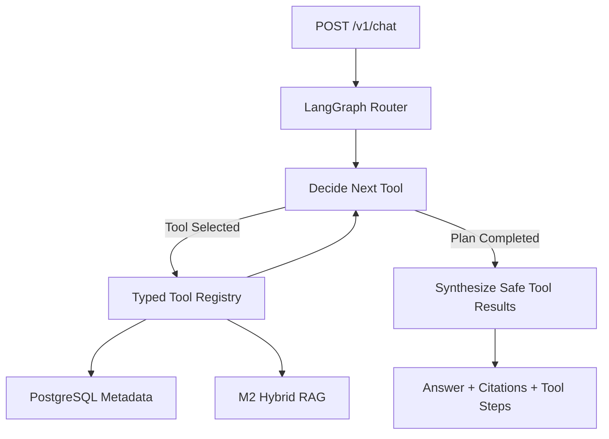

# M3 — Agent Core & Tool Calling

Status: **M3a Completed (2026-10-15); M3b next**.

## Scope split

- **M3a:** LangGraph StateGraph, typed Tool Registry, conditional graph
  transitions, two real tools and a `POST /v1/chat` endpoint.
- **M3b:** Entity extraction, document summary and model-assisted multi-tool
  decision making with a bounded fallback strategy.

M3a intentionally avoids inventing working memory, persistent chat history
or approval features. These belong to later modules (M4/M6).

## M3a Architecture



State includes: session_id, query, document_id, intent, plan,
tool_results, current_step, next_tool, sources, status and final_answer.
The graph currently has no checkpointer or cross-request memory.

### Tools and their real services

| Tool | Actual implementation | Purpose |
|---|---|---|
| `search_documents` | `app/rag/pipeline.py` | Dense/BM25 → RRF → BGE Rerank → Qwen answer with citations |
| `query_document_metadata` | `asyncpg` to PostgreSQL `documents` | List/lookup indexed document records |

Tool selection in M3a uses deterministic string rules: explicit file-list
and metadata requests select PostgreSQL; a substantive content question selects
RAG; some combined questions select both, with bounded steps.

This is **application-side structured Tool Calling**, not provider-native
LLM Function Calling. State and conditional execution are real LangGraph;
the tool selection itself is not yet an LLM-generated plan.

The tool registry uses Pydantic argument models. Unsupported tool names are
rejected rather than executed. There are **no write tools** in M3a.

### Why separate decision and tool execution?

The graph records which tool was selected, executes through one allowlisted
entry point, and decides whether another task remains. Tool output is
structured state rather than a free-form appended prompt.

M3a limits the plan to 1–2 tools and enforces 8 tool-step maximum.
Comprehensive timeout/retry/fallback policy belongs to M6.

### Run M3a

From Windows CMD:

```cmd
cd /d E:\project\DocMind-Agent
git pull
docker compose up -d --build api
scripts\check_m3a.bat
```

Keep the separate `llm-serving-ops` vLLM container on port 8000.
Embedding and reranker models reuse the existing persistent cache.

The integration test:

1. Uploads/indexes a synthetic document.
2. Calls `POST /v1/chat` to list its PostgreSQL metadata.
3. Calls `POST /v1/chat` for a content question.
4. Verifies that LangGraph invoked the correct real tools.
5. Verifies a cited Qwen answer and source document ID.

Expected: `M3a PASS` and `M3a validation passed.`

### Manual API example

After uploading and indexing a document, execute:

```cmd
curl --noproxy "*" -X POST http://127.0.0.1:8090/v1/chat -H "Content-Type: application/json" -d "{\"query\":\"列出已上传的文档\"}"
```

### Acceptance boundary

M3a passes only when the **real Docker API** and two independent tool
paths have been verified. GitHub Actions unit tests by themselves do not
establish end-to-end success.

M3 as a whole remains In Progress until M3b completes.
