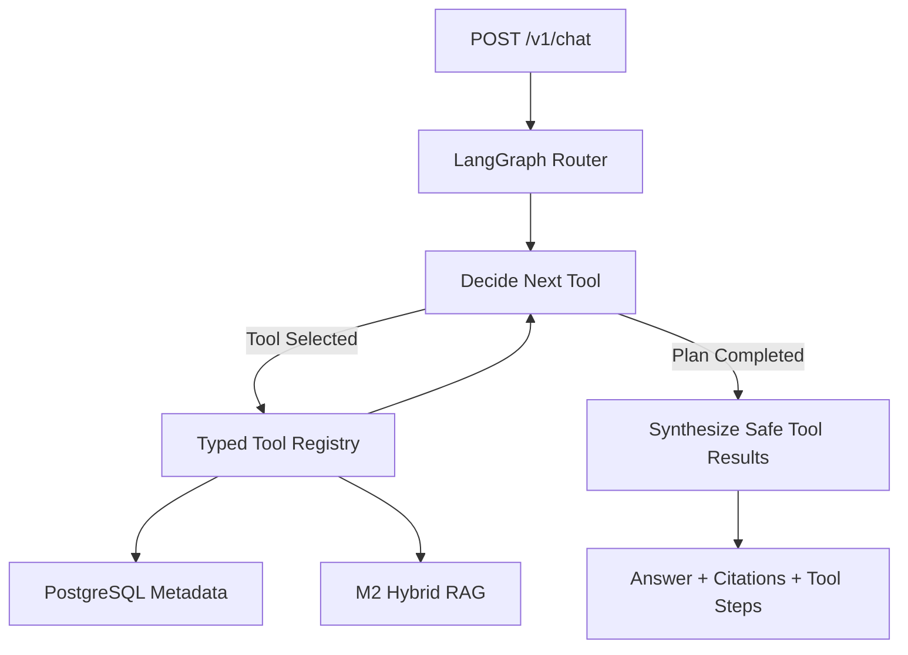

# M3 — Agent Core & Tool Calling

Status: **M3a + M3b Completed (2026-10-15) via local live integration tests**.

## Scope split

- **M3a:** LangGraph StateGraph, typed Tool Registry, conditional graph
  transitions, two real tools and a `POST /v1/chat` endpoint.
- **M3b:** Entity extraction, document summary and model-assisted multi-tool
  decision making with a bounded fallback strategy.

M3a intentionally avoids inventing working memory, persistent chat history
or approval features. These belong to later modules (M4/M6).

## M3a Architecture



State includes: session_id, query, document_id, intent, plan,
tool_results, current_step, next_tool, sources, status and final_answer.
The graph currently has no checkpointer or cross-request memory.

### Tools and their real services

| Tool | Actual implementation | Purpose |
|---|---|---|
| `search_documents` | `app/rag/pipeline.py` | Dense/BM25 → RRF → BGE Rerank → Qwen answer with citations |
| `query_document_metadata` | `asyncpg` to PostgreSQL `documents` | List/lookup indexed document records |

Tool selection in M3a uses deterministic string rules: explicit file-list
and metadata requests select PostgreSQL; a substantive content question selects
RAG; some combined questions select both, with bounded steps.

This is **application-side structured Tool Calling**, not provider-native
LLM Function Calling. State and conditional execution are real LangGraph;
the tool selection itself is not yet an LLM-generated plan.

The tool registry uses Pydantic argument models. Unsupported tool names are
rejected rather than executed. There are **no write tools** in M3a.

### Why separate decision and tool execution?

The graph records which tool was selected, executes through one allowlisted
entry point, and decides whether another task remains. Tool output is
structured state rather than a free-form appended prompt.

M3a limits the plan to 1–2 tools and enforces 8 tool-step maximum.
Comprehensive timeout/retry/fallback policy belongs to M6.

### Run M3a

From Windows CMD:

```cmd
cd /d E:\project\DocMind-Agent
git pull
docker compose up -d --build api
scripts\check_m3a.bat
```

Keep the separate `llm-serving-ops` vLLM container on port 8000.
Embedding and reranker models reuse the existing persistent cache.

The integration test:

1. Uploads/indexes a synthetic document.
2. Calls `POST /v1/chat` to list its PostgreSQL metadata.
3. Calls `POST /v1/chat` for a content question.
4. Verifies that LangGraph invoked the correct real tools.
5. Verifies a cited Qwen answer and source document ID.

Expected: `M3a PASS` and `M3a validation passed.`

### Manual API example

After uploading and indexing a document, execute:

```cmd
curl --noproxy "*" -X POST http://127.0.0.1:8090/v1/chat -H "Content-Type: application/json" -d "{\"query\":\"列出已上传的文档\"}"
```

### Acceptance boundary

M3a passes only when the **real Docker API** and two independent tool
paths have been verified. GitHub Actions unit tests by themselves do not
establish end-to-end success.

M3a and M3b have passed their live integration gates. See [M3B_ACCEPTANCE.md](M3B_ACCEPTANCE.md).

## M3b — Grounded extraction, summary and validated LLM tool ordering

### Four read-only tools

| Tool | Actual data source | Result |
|---|---|---|
| `search_documents` | M2 Hybrid RAG, BGE Reranker, Qwen | Source-cited answer |
| `query_document_metadata` | PostgreSQL | Structured document list |
| `extract_entities` | Qdrant source-chunk scan, deterministic patterns | Party names/payment term, each cited to a chunk |
| `summarize_document` | M2 Hybrid RAG scoped to document UUID | Source-cited summary of retrieved evidence |

The extractor matches explicitly labelled `甲方：...`, `乙方：...` and
payment-period clauses. Scans are capped at 200 chunks and raise an error
rather than silently omitting additional chunks. Unsupported entity
patterns may be missed; this is **not** an LLM-based legal NER model.

The summary tool retrieves evidence using M2 and invokes real Qwen.
It explicitly states it summarizes **retrieved excerpts only**, not every
page of a longer contract. Source-ID validation checks references, not
semantic entailment; claim-level faithfulness remains an M7 metric.

### Model-assisted ordering, with explicit fallback

A simple query uses rule-based routing with no extra LLM call.
When a complex query needs at least two extraction/summary-related tools,
one Qwen call proposes a JSON ordering of the *required tool set*.
The proposed list must contain exactly those required tools, without
duplicates, extra tools or omitted tasks. Invalid/unavailable model
responses trigger a rule fallback. Thus `llm_validated` means constrained
model-assisted **ordering**, not open-ended autonomous task planning.

API field `plan_source` records `rules`, `llm_validated` or
`rule_fallback`; `planner_fallback_reason` contains a high-level reason.
The maximum Agent tool steps remains eight; M6 will add systematic
per-tool timeout/retry and HITL policies.

### Global citation safety

Two independent tools can both cite `[S1]` while referring to different
source chunks. The synthesis node rewrites these into a single response
namespace, e.g. first tool `[S1]`, second tool `[S2]`, and updates
structured extracted facts' `source_id` fields to match.

### Local end-to-end validation

```cmd
cd /d E:\project\DocMind-Agent
git pull
docker compose up -d --build api
scripts\check_m3b.bat
```

Keep `llm-serving-ops` vLLM running on host port 8000. Existing
ModelScope ONNX weights are reused; no new model download is required.

The test checks real extraction of both contract parties and a 30-day
payment period; a live Qwen evidence-scoped summary; a combined two-tool
LangGraph task; and globally unique citation IDs.

Expected: `PASS cited deterministic entity extraction`,
`PASS evidence-scoped live Qwen summary`,
`PASS multi-tool LangGraph plan + unique citations`, then `M3b PASS`.

### Not yet implemented

- M4: Redis session memory, long-term memory and durable checkpoints.
- M5: real MCP client/server communication.
- M6: full timeout/retry/fallback and approval-protected writes.
- M7: retrieval/evidence factuality and Agent task-success metrics.
